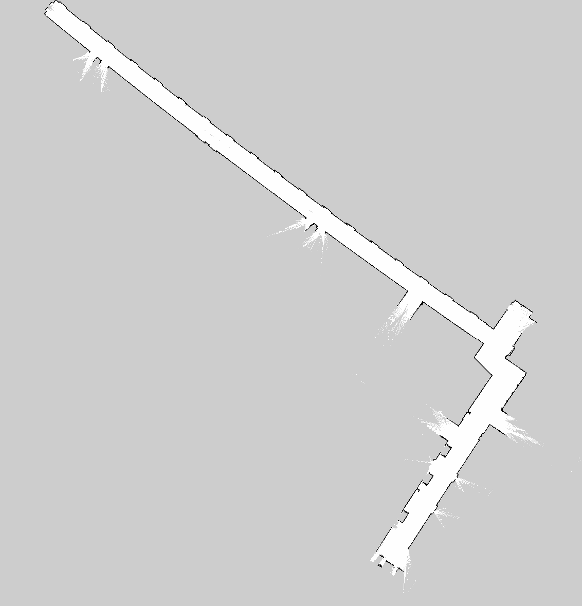

# LionBot Senior Design Project

LionBot is a differential-drive mobile robotics senior design project built around ROS 2. The robot uses LiDAR, wheel encoders, SLAM, localization, and Navigation2 to map an environment and autonomously navigate to user-selected destinations.

The project does not use a camera and does not currently include object tracking or object-following behavior.

## Current Project Status

**Updated November 9, 2026**

LionBot has successfully demonstrated autonomous navigation, turning, obstacle avoidance, collision protection, recovery behavior, SLAM mapping, and AMCL localization on the physical robot.

Verified capabilities include:

- Raspberry Pi 5 running Ubuntu 24.04 and ROS 2 Jazzy
- Arduino UNO R4 Minima communication and motor control
- Physical differential-drive movement
- Functional left and right wheel encoders
- Encoder-based wheel odometry
- Calibrated straight-line and rotational odometry
- RPLIDAR A1 publishing real `/scan` data
- Complete TF structure
- SLAM Toolbox mapping on the physical robot
- Saved occupancy-grid maps
- AMCL localization on saved maps
- Nav2 global path planning
- Rotation Shim + MPPI local control
- LiDAR-based local and global costmaps
- Collision Monitor integration
- RViz destination selection
- Autonomous movement to selected destinations
- Reliable 90-degree turning during navigation
- Static obstacle detection and avoidance
- Nav2 recovery behaviors
- Successful autonomous goal completion
- New third-floor hallway SLAM map
- Cleaned hallway occupancy map for Nav2
- Successful AMCL localization on the hallway map
- Successful Nav2 stack activation on the hallway map

The current development focus is final hallway navigation testing, establishing repeatable preset destinations, web-interface integration, and final demonstration reliability.

## System Hardware

### Main Computer

- Raspberry Pi 5
- Ubuntu 24.04 LTS
- ROS 2 Jazzy
- ROS 2 workspace: `~/dev_ws`

### Drive System

- Two independently driven DC gear motors
- Wheel encoders on both motors
- Differential-drive configuration
- Cytron SmartDriveDuo-30 (MDDS30) motor driver
- Arduino UNO R4 Minima for low-level motor and encoder interfacing
- Replacement wheels installed in place of the previous tracked-drive configuration

### Sensors

- RPLIDAR A1 360-degree LiDAR
- Left wheel encoder
- Right wheel encoder
- IMU not currently integrated

## System Architecture

The current navigation/control path is approximately:

```text
RViz / Web Interface
        |
        v
Navigation2
        |
        v
Rotation Shim Controller
        |
        v
MPPI Controller
        |
        v
Velocity Smoother
        |
        v
Collision Monitor
        |
        v
     /cmd_vel
   TwistStamped
        |
        v
diff_drive_controller
        |
        v
   ros2_control
        |
        v
LionBotSystemHardware
        |
        v
Arduino UNO R4 Minima
        |
        v
Cytron MDDS30
     /       \
Left Motor   Right Motor
```

Encoder feedback follows the reverse path:

```text
Wheel Encoders
      |
      v
Arduino UNO R4
      |
      v
LionBotSystemHardware
      |
      v
ros2_control
      |
      v
diff_drive_controller
      |
      +--> /diff_drive_controller/odom
      |
      +--> odom -> base_footprint TF
```

LiDAR data is used by:

```text
RPLIDAR A1
    |
    v
  /scan
    |
    +--> SLAM Toolbox
    +--> AMCL
    +--> Local Costmap
    +--> Global Costmap
    +--> Collision Monitor
```

## ROS 2 Packages

### `lionbot_description`

Contains the LionBot URDF/Xacro description, physical dimensions, TF structure, LiDAR mounting transform, and ros2_control hardware declaration.

Important frames include:

- `map`
- `odom`
- `base_footprint`
- `base_link`
- `laser`

The static chassis transform includes:

```text
base_footprint -> base_link
Z = 0.031 m
```

The measured LiDAR transform is approximately:

```text
base_link -> laser
X = 0.0975 m
Y = 0.035 m
Z = 0.364 m
Yaw = +90 degrees
```

### `lionbot_hardware`

Provides the custom ROS 2 hardware interface between ros2_control and the Arduino UNO R4 Minima.

Current functionality includes:

- USB serial communication
- Motor velocity command transmission
- Encoder count feedback
- Wheel position calculation
- Wheel velocity feedback
- ROS 2 hardware interface registration
- Integration with `diff_drive_controller`

The right motor command is inverted in software so both physical wheels move in the correct direction for forward and reverse commands.

### `lionbot_bringup`

Contains primary launch and configuration files for:

- Robot description
- ros2_control
- `diff_drive_controller`
- LiDAR
- SLAM
- Navigation2
- AMCL
- Costmaps
- Collision Monitor

Important files include:

```text
lionbot_bringup/launch/lionbot.launch.py
lionbot_bringup/launch/navigation.launch.py
lionbot_bringup/config/controllers.yaml
lionbot_bringup/config/nav2.yaml
```

### `firmware`

Contains Arduino firmware and supporting motor/encoder test programs.

Important files include:

```text
firmware/lionbot_arduino/lionbot_arduino.ino
firmware/encoder_calibration/encoder_calibration.ino
firmware/encoder_test/encoder_test.ino
firmware/motor_test/motor_test.ino
firmware/signed_encoder_test/signed_encoder_test.ino
```

## Arduino Communication and Safety

The Raspberry Pi communicates with the Arduino through USB serial.

The Arduino supports commands such as:

```text
PING
STATUS
ARM
DISARM
STOP
DRIVE,<LEFT>,<RIGHT>
```

Drive commands use a range of approximately:

```text
-100 to 100
```

The Arduino firmware includes a communication-loss failsafe. If valid drive commands stop arriving while the drive system is armed, the Arduino returns the motor outputs to neutral and disarms the drive interface.

This behavior has been successfully tested.

## Encoder and Odometry Calibration

Both wheel encoders have been verified on the physical robot.

Current calibrated encoder counts per revolution are:

```text
Left:  2451
Right: 2405
```

A straight-line calibration test used a measured physical distance of approximately 1.56 m.

The differential-drive rotational calibration currently uses:

```yaml
wheel_separation: 0.370
wheel_separation_multiplier: 1.66
```

After calibration, an approximately 90-degree physical turn produced an odometry estimate of approximately 86 degrees.

Encoder odometry is published at approximately 20 Hz on:

```text
/diff_drive_controller/odom
```

The controller also publishes:

```text
odom -> base_footprint
```

## RPLIDAR A1

The RPLIDAR A1 is operational on the Raspberry Pi.

Typical device:

```text
/dev/ttyUSB0
```

ROS topic:

```text
/scan
```

Verified characteristics include:

- Frame: `laser`
- Minimum range: approximately 0.15 m
- Maximum range: 12.0 m
- Typical scan rate: approximately 7 Hz

The LiDAR is used by SLAM Toolbox, AMCL, Nav2 costmaps, and Collision Monitor.

## SLAM and Mapping

SLAM Toolbox has been successfully run on the physical LionBot.

### Original Lab Map

The original calibrated development map is stored on the Pi as:

```text
/home/elli/lionbot_map_final.yaml
/home/elli/lionbot_map_final.pgm
```

### Hallway Map

On November 9, 2026, LionBot was driven through the intended third-floor hallway while running SLAM Toolbox.

The hallway map was saved and then cleaned to remove small occupied-cell artifacts caused by temporary objects and people present during mapping.

The cleaned map files stored in this repository are:

```text
maps/lionbot_demo_hallway_clean.yaml
maps/lionbot_demo_hallway_clean.pgm
maps/lionbot_demo_hallway_clean.png
```

The working copy on the Raspberry Pi is:

```text
/home/elli/lionbot_demo_hallway_clean.yaml
/home/elli/lionbot_demo_hallway_clean.pgm
```

Map resolution:

```text
0.05 m/cell
```

### Cleaned Hallway Map



The original unedited hallway map was preserved separately before cleanup.

AMCL successfully localized LionBot on the cleaned hallway map, and the Navigation2 stack activated without errors. Autonomous hallway destination testing has not yet been performed.

## Navigation2

Navigation2 is installed, configured, and operational on the physical robot.

Current major components include:

- AMCL localization
- NavFn global planner
- Rotation Shim Controller
- MPPI local controller
- Differential-drive MPPI motion model
- Local costmap
- Global costmap
- Static map layer
- Obstacle layers
- Inflation layers
- Velocity smoother
- Collision Monitor
- Nav2 behavior server

The robot footprint is based on measured LionBot dimensions.

Configured footprint:

```text
X: approximately +/-0.2275 m
Y: approximately +/-0.2125 m
```

Nav2 applies approximately 0.01 m of additional footprint padding.

### Odometry Topic Correction

During physical Nav2 testing, the active encoder odometry was found to be published on:

```text
/diff_drive_controller/odom
```

while some Nav2 components were configured for `/odom`.

`controller_server` and `bt_navigator` were updated to use:

```text
/diff_drive_controller/odom
```

This significantly improved physical navigation behavior.

### Rotation Shim Controller

The Rotation Shim Controller is used around MPPI to handle substantial heading changes before path following.

Important current settings include:

```yaml
rotate_to_heading_angular_vel: 0.6
max_angular_accel: 1.5
rotate_to_goal_heading: true
rotate_to_heading_once: true
closed_loop: false
```

During testing, `closed_loop: true` caused LionBot's initial angular command to remain near approximately `0.075 rad/s`, which was too small to consistently overcome drivetrain static friction.

Changing:

```yaml
closed_loop: false
```

allowed the commanded angular velocity to ramp toward `0.6 rad/s`. After this change, LionBot successfully completed repeated 90-degree navigation turns without entering repeated progress-recovery cycles.

### Progress Checking

LionBot currently uses a pose-based progress checker:

```yaml
plugin: "nav2_controller::PoseProgressChecker"
required_movement_radius: 0.5
required_movement_angle: 0.10
movement_time_allowance: 10.0
```

This allows translational or rotational movement to satisfy the progress check.

### Velocity Command Chain

LionBot uses `geometry_msgs/msg/TwistStamped` throughout the Nav2 velocity-command path.

```text
/cmd_vel_nav
      |
      v
Velocity Smoother
      |
      v
/cmd_vel_smoothed
      |
      v
Collision Monitor
      |
      v
/cmd_vel
      |
      v
diff_drive_controller
```

For manual SLAM mapping with `teleop_twist_keyboard`, stamped commands are required:

```bash
ros2 run teleop_twist_keyboard teleop_twist_keyboard \
  --ros-args -p stamped:=true -r cmd_vel:=/cmd_vel
```

## Verified Autonomous Navigation

LionBot has completed multiple physical autonomous Navigation2 tests.

Verified behaviors now include:

- Straight-line autonomous navigation
- Navigation to RViz-selected destinations
- Approximately 90-degree initial turns
- Turning in both directions
- Final heading adjustment
- Static obstacle detection
- Static obstacle avoidance
- Collision-aware recovery behavior
- Backup recovery behavior
- Recovery spin behavior
- Costmap clearing and replanning
- Successful goal completion

During deliberate obstacle testing, LionBot successfully navigated around an obstacle placed in its intended travel path and reached the requested destination without requiring recovery behavior.

During another test near a mapped table boundary, Nav2 detected an unsafe recovery spin and reported:

```text
Collision Ahead - Exiting Spin
```

rather than forcing the robot into the obstacle. Nav2 subsequently used additional recovery behavior and successfully reached the goal.

## Current Nav2 Startup Procedure

### 1. Start LionBot Hardware and LiDAR

```bash
source ~/dev_ws/install/setup.bash
ros2 launch lionbot_bringup lionbot.launch.py \
  use_lidar:=true \
  serial_port:=/dev/ttyUSB0
```

### 2. Start Nav2

For the cleaned hallway map:

```bash
source ~/dev_ws/install/setup.bash

ros2 launch nav2_bringup bringup_launch.py \
  slam:=False \
  map:=/home/elli/lionbot_demo_hallway_clean.yaml \
  params_file:=/home/elli/dev_ws/install/lionbot_bringup/share/lionbot_bringup/config/nav2.yaml \
  use_sim_time:=False \
  use_composition:=False \
  autostart:=False
```

For the original lab map, replace the map argument with:

```text
/home/elli/lionbot_map_final.yaml
```

### 3. Activate Localization

```bash
source ~/dev_ws/install/setup.bash

ros2 service call /lifecycle_manager_localization/manage_nodes \
  nav2_msgs/srv/ManageLifecycleNodes "{command: 0}"
```

### 4. Set Initial Pose in RViz

Set:

```text
Fixed Frame: map
```

Use:

```text
2D Pose Estimate
```

Place LionBot at its actual physical location on the map.

**The pose arrow must point in the same direction as LionBot's physical front.**

Verify that the live LiDAR scan aligns with the saved map before beginning navigation.

### 5. Activate Navigation

```bash
source ~/dev_ws/install/setup.bash

ros2 service call /lifecycle_manager_navigation/manage_nodes \
  nav2_msgs/srv/ManageLifecycleNodes "{command: 0}"
```

### 6. Send Navigation Goal

Use RViz:

```text
Nav2 Goal / 2D Goal Pose
```

Select the desired destination and final heading.

## Current Development Status

### Completed

- Raspberry Pi 5 setup
- Ubuntu 24.04 / ROS 2 Jazzy installation
- ROS workspace and GitHub repository
- Arduino UNO R4 communication
- Motor controller integration
- Motor command failsafe logic
- Physical drivetrain operation
- Wheel encoder wiring and verification
- Encoder feedback through ROS
- Straight-line odometry calibration
- Rotational odometry calibration
- `diff_drive_controller`
- Encoder odometry
- `odom -> base_footprint`
- RPLIDAR A1 integration
- LiDAR TF
- Real `/scan` data
- Physical SLAM
- Original lab occupancy map
- Third-floor hallway SLAM map
- Cleaned hallway occupancy map
- AMCL localization
- Nav2 configuration
- NavFn global planning
- Rotation Shim Controller
- MPPI local control
- Costmaps
- Collision Monitor
- TwistStamped Nav2 command chain
- RViz goal selection
- Physical autonomous navigation
- Reliable 90-degree navigation turns
- Static obstacle avoidance
- Collision-aware recovery behaviors
- Successful autonomous goal completion
- AMCL localization on cleaned hallway map
- Nav2 startup verification on cleaned hallway map

### Remaining Work

Primary remaining technical work includes:

1. Perform autonomous navigation tests on the cleaned hallway map.
2. Establish a repeatable physical Home position and orientation.
3. Select and record preset hallway destination poses.
4. Test longer hallway navigation routes.
5. Verify obstacle avoidance in the hallway environment.
6. Continue final navigation reliability testing.
7. Integrate preset Nav2 destinations with the web application.
8. Add web-interface robot connection/navigation status.
9. Add web-interface cancel/stop and Raspberry Pi shutdown controls.
10. Complete final integrated demonstration testing.

An IMU remains optional and is not currently required for the demonstrated navigation system.

## Planned Web Interface

The planned LionBot web application will allow a phone, laptop, or tablet on the same network as the Raspberry Pi to communicate with LionBot without requiring a public domain.

Planned features include:

- Preset destination selection
- Navigation command submission
- Robot/Pi online status
- Navigation status
- Cancel navigation
- Return Home
- Raspberry Pi shutdown command
- Map display
- Current destination indication

The Raspberry Pi will host the application locally and communicate with ROS 2 / Nav2.

## Final Project Goal

LionBot is intended to:

- Build an environment map using LiDAR and SLAM.
- Localize itself on a saved map.
- Accept a user-selected destination.
- Plan a path to that destination.
- Navigate autonomously using wheel odometry and LiDAR.
- Detect obstacles with LiDAR.
- Avoid obstacles while navigating.
- Reach selected destinations reliably.
- Allow navigation commands to be issued through a simple web interface.

The core physical autonomous-navigation system has now been demonstrated successfully. Current work is focused on hallway deployment, preset destinations, web-interface integration, and final demonstration reliability.
